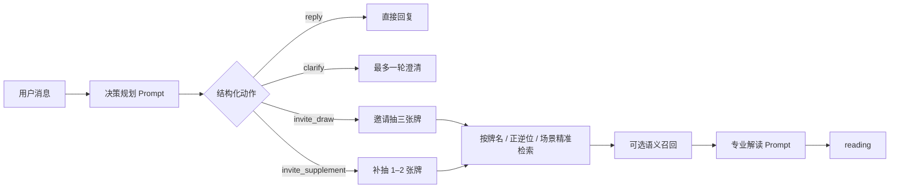

# Arcana Oracle Agent

一个基于知识库的多轮塔罗占卜对话 Agent。它先判断用户是否真的在发起占卜、问题是否需要澄清，再决定直接回复、邀请抽牌、生成解读或补充抽牌。在线体验：[tarot.zoeyw.me](https://tarot.zoeyw.me)

> 公开仓库使用简化示例知识。线上版本的书籍资料、完整知识库、向量索引和牌面素材未公开，详见 [NOTICE.md](NOTICE.md)。

## 产品问题

常见线上塔罗产品会把任意输入直接当作占卜问题，模糊问题缺少引导；用户也很难在原对话中继续追问、补抽牌或自然地开启新咨询。Arcana Oracle 把这些判断交给 Agent，在一个连续会话里完成从问题收束到补充解读的流程。

## Agent 工作流



五类动作由模型以 JSON 输出，服务端做白名单校验并结合会话状态路由：

- `reply`：无需抽牌，直接回应或承接已有牌面。
- `clarify`：问题过于模糊时追问一次。
- `invite_draw`：问题已经明确，生成问题摘要并邀请抽三张牌。
- `reading`：结合问题、牌位和检索证据生成解读。
- `invite_supplement`：现有牌面不足以回答新增角度时邀请补牌。

三张牌的分析位置由 Agent 根据问题类型选择或拟定，不机械限定为过去、现在、未来。知识检索先锁定实际抽到的牌与正逆位，再按爱情、事业或精神主题取回牌面象征、场景牌义和智慧指引；语义召回只在允许的牌与方向中补充结果。

## 技术结构

- 原生 HTML/CSS/JavaScript：对话界面、历史会话、透明旋转牌阵和点击抽牌
- Node.js Edge 风格接口：Agent 规划、状态校验、RAG 与模型调用
- DeepSeek：结构化决策和自然语言解读
- Jina Embeddings：可选的语义召回；缺少索引或 Key 时自动保留精确检索
- Node Test Runner：覆盖动作约束、澄清轮次、抽牌邀请、正逆位隔离和检索降级

## 本地运行

需要 Node.js 20 或更高版本。

```bash
cp .env.example .env
# 在 .env 中填写 DEEPSEEK_API_KEY；JINA_API_KEY 可选
npm run dev
```

打开 `http://127.0.0.1:4173`。运行校验：

```bash
npm test
npm run build
```

## 部署

后端可用根目录的 `render.yaml` 部署到 Render，并在平台配置 `DEEPSEEK_API_KEY` 与可选的 `JINA_API_KEY`。前端可部署到 Vercel；将 `vercel.example.json` 复制为 `vercel.json`，再把示例后端地址替换成自己的 Render 地址。

## 项目结构

```text
lib/       Agent 决策、Prompt 与检索逻辑
server/    API handlers
data/      公开演示知识（非生产知识库）
js/        对话与牌阵交互
tests/     工作流和检索校验
docs/      架构说明
```

本产品用于娱乐与自我反思，不替代医疗、法律、财务或其他专业建议。
